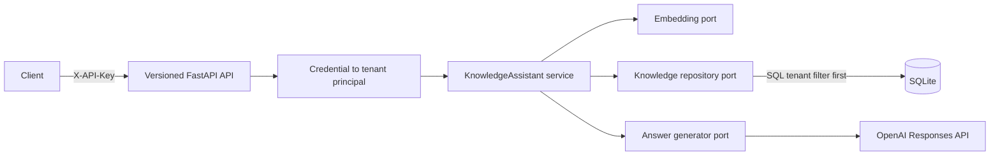

# Architecture

## Goal

Provide grounded answers over tenant-owned documents while ensuring one tenant
cannot list, retrieve, query, or delete another tenant's data.

## Request flow



Tenant identity is established once at the HTTP boundary and passed explicitly
to every service and repository operation. It is never accepted from a document
or query payload. The SQLite adapter applies `WHERE tenant_id = ?` before any
retrieval scores are calculated.

## Ingestion flow

1. Normalize and size-check document content.
2. Calculate a SHA-256 content hash.
3. Check for the same hash within the authenticated tenant.
4. Split content at semantic boundaries.
5. Embed chunks in bounded batches constrained by item count and token budget.
6. Save document metadata and chunks in one transaction.
7. Resolve a concurrent duplicate as an idempotent success.

The content hash is tenant-scoped. Two tenants may independently ingest the same
content without sharing records.

## Retrieval and answering

The reference adapter combines cosine similarity and lexical token overlap:

```text
score = semantic_weight × cosine + (1 - semantic_weight) × lexical
```

If the highest result is below the configured threshold, the service abstains
without calling the language model. Otherwise, retrieved chunks are serialized
as untrusted JSON source data and the generator requests inline numbered
citations. Citation objects are assembled from retrieved records, not invented
by the model. Only valid source numbers cited in the generated answer are returned;
missing or nonexistent citation numbers make the provider response fail closed.

## Trust boundaries

- API keys are secrets and map to exactly one tenant.
- Tenant IDs cannot be supplied by API callers.
- Retrieved documents are untrusted data and may contain malicious instructions.
- Provider SDK failures are translated inside the adapter and become a generic
  503 response; invalid provider output becomes a generic 502 response.
- Secrets are loaded from environment configuration and never returned.
- Generated responses are not stored by OpenAI unless an operator explicitly
  enables that data-retention choice.
- Delete operations include tenant ID in the SQL predicate and return 404 for
  both missing and cross-tenant documents.

Prompt instructions reduce indirect prompt-injection risk but are not a complete
control. Later milestones add adversarial evals, content provenance, action-level
authorization, and isolation between retrieval and write-capable tools.

## Scaling decisions

SQLite makes transactions and tenant filters visible, which is valuable while
learning. Its vector scan is O(number of chunks for a tenant) and should be
replaced for large corpora. The `KnowledgeRepository` port allows a pgvector,
OpenSearch, or managed retrieval adapter to replace it without changing use-case
logic.

Similarly, `EmbeddingProvider` and `AnswerGenerator` isolate model vendors. Model
changes must be evaluated on the same dataset rather than treated as configuration
updates with assumed equivalence.

## Operational gaps intentionally left visible

- Schema migration tooling
- Background ingestion and job status
- OCR and document-type parsers
- Enterprise OIDC/JWT authentication
- Per-document ACLs beneath tenant scope
- Distributed tracing and metrics export
- Rate limits, quotas, and abuse detection
- Learned reranking and a scalable hybrid index
- Continuous answer-quality and security evaluations

These are the ordered learning milestones, not hidden claims that a demo database
already solves production operations.
