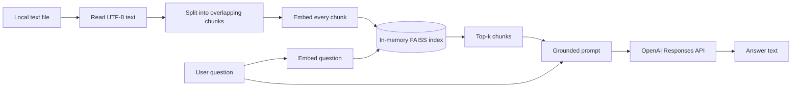

# Milestone 0 — Minimal RAG loop

- **Status:** Complete
- **Primary implementation:** [`rag.py`](../../rag.py)
- **Primary tests:** [`test_rag.py`](../../test_rag.py)

## Purpose

Milestone 0 is the smallest useful retrieval-augmented generation (RAG) system in
this repository. It keeps the entire pipeline in one module so the mechanics are
easy to see before Milestone 1 separates them into production-oriented layers.

The system answers a question from one local text file by:

1. loading and chunking the file;
2. embedding the chunks;
3. indexing the vectors in FAISS;
4. embedding the question and retrieving the nearest chunks;
5. placing only those chunks in the prompt; and
6. asking an OpenAI model to compose an answer from that context.

## What this milestone teaches

- Why text must be converted into embeddings before semantic retrieval.
- How chunk size and overlap determine the retrievable units of evidence.
- How `top_k` controls the amount of retrieved evidence.
- Why retrieval and generation are separate operations.
- How retrieved evidence becomes model context.
- Why deterministic provider fakes are important in unit tests.

## Scope and boundaries

Milestone 0 deliberately supports one document and one process. Its vector index
is rebuilt every time the CLI runs. It has no tenant identity, persistent index,
document lifecycle, validated citations, evaluation dataset, or production API.

The repository's HTTP API now points to the Milestone 1 application. This keeps
the original RAG code useful as a comparison baseline without maintaining two
competing APIs.

## End-to-end flow



At runtime, [`main()`](../../rag.py) coordinates the whole sequence. The smaller
functions can also be used and tested independently.

## Step 1: load and chunk the document

`load_document_chunks(document_path)` first verifies that the path exists, then
reads it as UTF-8. It uses LangChain's `RecursiveCharacterTextSplitter` with:

- chunk size: `500` characters;
- chunk overlap: `50` characters; and
- source metadata containing the original file path.

The recursive splitter prefers natural text boundaries supported by its default
separator strategy, then falls back to smaller boundaries when necessary. The
overlap repeats a small amount of neighboring text so a fact near a chunk boundary
is less likely to lose its surrounding context.

These values are intentionally simple defaults, not proven optimal settings.
Milestone 3 evaluates chunking choices against a representative dataset.

## Step 2: embed and index the chunks

`build_vector_store(documents, embeddings)` calls
`FAISS.from_documents(documents, embeddings)`.

For the runnable CLI, the embedding implementation is LangChain's
`OpenAIEmbeddings` using `text-embedding-3-small`. Conceptually:

```text
chunk text -> embedding model -> numeric vector -> FAISS index
```

An embedding is a numeric representation whose geometry captures aspects of
semantic similarity. FAISS stores those vectors and supports nearest-neighbor
lookup. At this stage, the original chunk text and metadata remain associated
with each indexed vector through the LangChain vector-store wrapper.

The index exists only in memory. Stopping the process discards it.

## Step 3: retrieve relevant chunks

`retrieve_chunks(vector_store, query, top_k)` validates that `top_k` is positive
and delegates to `vector_store.similarity_search(query, k=top_k)`.

The vector store:

1. embeds the question with the same embedding model used for the chunks;
2. compares the question vector with the indexed chunk vectors; and
3. returns up to `top_k` nearest documents.

Retrieval does not answer the question. It selects the evidence that the language
model is allowed to use. A poor retrieval result can therefore produce a poor
answer even when the generation model is strong.

The default `top_k` is `3`. A larger value can improve recall but also adds noise
and consumes more prompt tokens. A smaller value is cheaper and more focused but
can omit necessary evidence.

## Step 4: construct grounded context

`build_prompt(query, retrieved_docs)` numbers the selected chunks and builds this
logical prompt structure:

```text
Use the context below to answer the question.
If the answer is not supported by the context, say you do not know.

Context:
[Chunk 1]
...

[Chunk 2]
...

Question: ...
```

Only `retrieved_docs` are included. The full source document is not silently sent
to the model. This distinction is the core of RAG: retrieval determines context;
generation interprets that context.

The prompt asks the model to admit insufficient evidence. In Milestone 0 this is
only a prompt instruction. The application does not parse an abstention sentinel
or verify that the answer is actually grounded.

## Step 5: generate the answer

`answer_question(...)` performs retrieval, creates the prompt, and calls:

```python
client.responses.create(
    model=model,
    instructions=INSTRUCTIONS,
    input=prompt,
)
```

The default generation model is `gpt-4.1-mini`. The method reads
`response.output_text`, strips whitespace, and rejects an empty answer. It returns
both the answer and the retrieved documents so the CLI can optionally display the
evidence.

Milestone 0 does not validate citations, record token use, classify provider
failures behind application errors, or explicitly configure provider-side
response storage. Those concerns are implemented in Milestone 1.

## Step 6: CLI behavior

The CLI loads `.env`, checks `OPENAI_API_KEY`, builds the index, and asks the
question. Its options are:

| Option | Default | Meaning |
|---|---:|---|
| `--document` | `data/document.txt` | UTF-8 source file to index |
| `--query` | `What is TowerZ?` | Question to ask |
| `--top-k` | `3` | Maximum retrieved chunks |
| `--model` | `gpt-4.1-mini` | Generation model |
| `--show-context` | off | Print retrieved chunks before the answer |

Run it with:

```bash
python rag.py --query "What is TowerZ?" --show-context
```

The command requires network access and a valid `OPENAI_API_KEY`. It creates new
embeddings on each run because the FAISS index is not persisted.

## Function map

| Function | Responsibility | External dependency |
|---|---|---|
| `load_document_chunks` | Read and split one file | LangChain text splitter |
| `build_vector_store` | Embed chunks and build index | Embedding provider, FAISS |
| `retrieve_chunks` | Return nearest chunks | FAISS vector store |
| `build_prompt` | Serialize only retrieved context | None |
| `answer_question` | Retrieve, prompt, and generate | OpenAI-compatible client |
| `parse_args` | Define CLI inputs | Python `argparse` |
| `main` | Configure and orchestrate the run | Environment, OpenAI |

## Failure behavior

| Condition | Behavior |
|---|---|
| Missing `OPENAI_API_KEY` | Prints a configuration message and exits with code 1 |
| Missing document | Prints the missing path and exits with code 1 |
| `top_k < 1` | Raises `ValueError`; CLI reports a configuration error |
| Empty model answer | Raises `ValueError`; CLI reports a configuration error |
| OpenAI connection failure | Prints a connection message and exits with code 1 |
| Other provider or parsing failures | Not normalized at this milestone |

## Deterministic test strategy

[`test_rag.py`](../../test_rag.py) never calls OpenAI. It uses
`KeywordEmbeddings`, a deterministic three-dimensional embedding based on the
presence of the words `towerz`, `strategy`, and `invoice`.

The tests prove that:

- long source text is split into multiple chunks;
- semantic search returns the expected chunk;
- the prompt contains the retrieved chunk and question;
- answer generation receives retrieved context; and
- the generated text and retrieved documents are returned together.

Run the tests with:

```bash
python -m unittest test_rag -v
```

These are unit tests of pipeline mechanics. They do not prove real-model answer
quality; that requires a versioned evaluation dataset and repeated measurements.

## Completion evidence

| Exit criterion | Evidence |
|---|---|
| Single-document ingestion | `load_document_chunks` reads and chunks the configured file |
| FAISS similarity search | `build_vector_store` and `retrieve_chunks` |
| OpenAI answer generation | `answer_question` uses the Responses API client |
| CLI example | `main`, `parse_args`, and the command above |
| Known question retrieves expected chunk | `test_similarity_search_returns_relevant_chunk` |
| Only retrieved context reaches generation | `test_prompt_contains_only_retrieved_chunks` and `test_answer_question_sends_retrieved_context_to_openai` |
| Tests make no external calls | Deterministic embedding and response fakes in `test_rag.py` |

## What is intentionally not solved here

- Multi-tenancy and authorization
- Durable document or vector storage
- Idempotent ingestion and deletion
- Hybrid lexical and semantic retrieval
- Citation validation and structured provenance
- Provider-neutral interfaces and errors
- Prompt-injection boundaries
- Token, latency, cost, and quality evaluation
- Background ingestion, observability, and operational controls

Those omissions are useful: they make the limits of a minimal RAG demo visible.
Milestone 1 addresses the application structure and tenant boundary; later
milestones address evaluation, retrieval quality, enterprise security, LLMOps,
agents, and scale.

## Suggested learning exercises

1. Change `--top-k` from 1 to 5 and inspect how the prompt changes.
2. Change chunk size and overlap, then observe which passages are retrieved.
3. Ask a question absent from the document and inspect whether the model abstains.
4. Add an irrelevant paragraph containing similar keywords and observe the
   difference between lexical resemblance and semantic relevance.
5. Trace one query through every function and identify where retrieval ends and
   generation begins.

The goal is not to tune this baseline into production. It is to understand its
mechanics well enough to recognize why the Milestone 1 boundaries are necessary.
