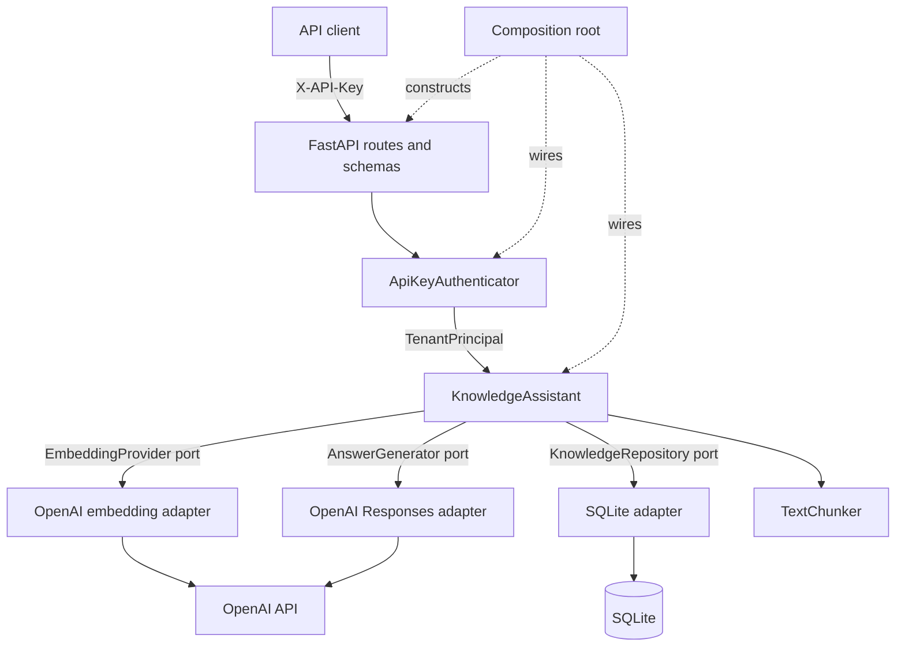
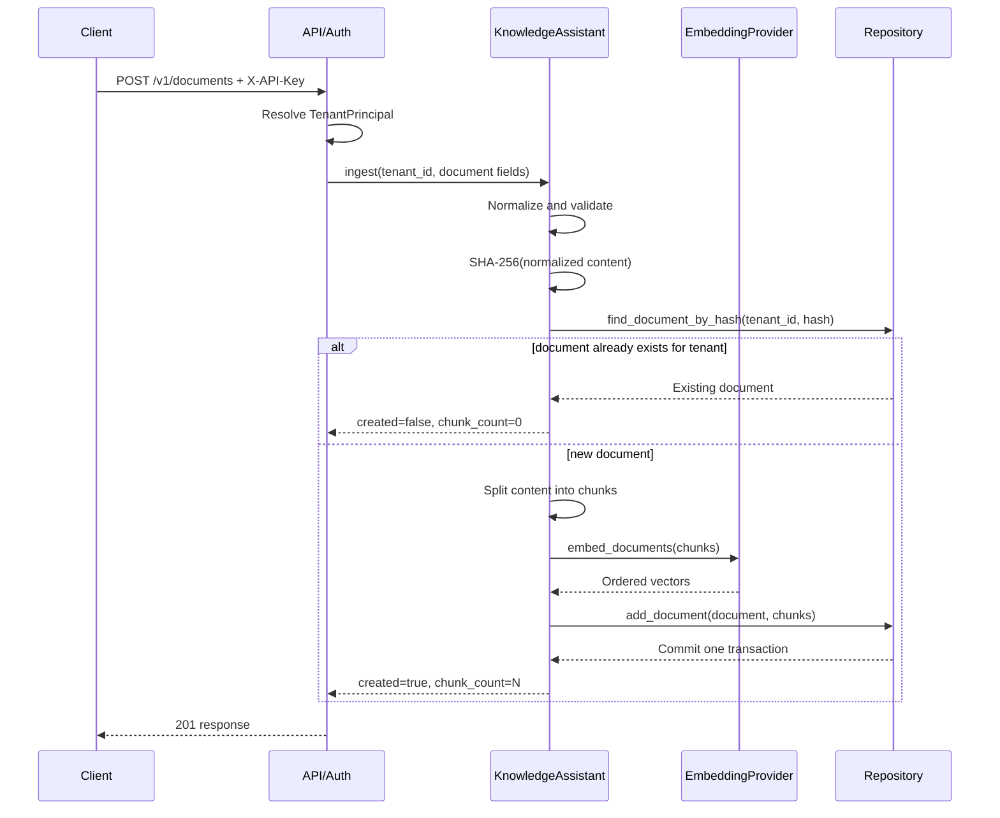
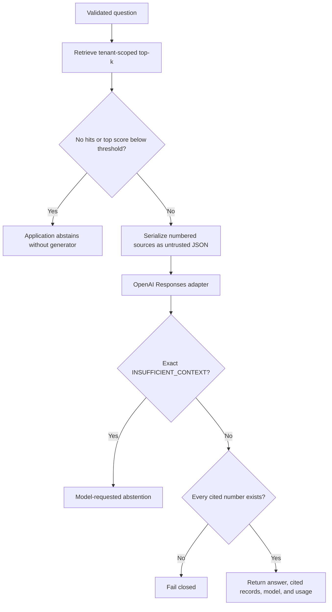

# Milestone 1 — Architecture and tenant isolation

- **Status:** Complete
- **Application package:** [`knowledge_assistant/`](../../knowledge_assistant/)
- **HTTP entry point:** [`api.py`](../../api.py)
- **Architecture decisions:** [`ADR 0001`](../adr/0001-ports-and-adapters.md),
  [`ADR 0002`](../adr/0002-tenant-from-credentials.md)

## Purpose

Milestone 1 turns the single-file RAG demonstration into a durable,
production-oriented application core. The principal design rule is that tenant,
grounding, and document-lifecycle policies must not depend on FastAPI, SQLite,
LangChain, or the OpenAI SDK.

This milestone establishes the boundaries needed for later improvements. It does
not claim that the current SQLite adapter, static API keys, or local deployment
are sufficient for a large enterprise deployment.

## What this milestone teaches

- Ports-and-adapters architecture for AI applications
- Domain models and framework-independent application services
- Dependency inversion and composition roots
- Credential-derived tenant context and trust boundaries
- Transactional, idempotent document ingestion
- Hybrid semantic and lexical retrieval
- Pre-generation and model-requested abstention
- Grounded generation with validated citations
- Provider error translation and explicit data-retention settings
- Deterministic testing of model-dependent workflows
- Initial offline retrieval evaluation

## Architecture at a glance



Dependencies point inward:

```text
API and adapters -> ports and application service -> domain models/errors
```

The domain and service layers do not import FastAPI, SQLite, or OpenAI. Concrete
technology is selected only in
[`knowledge_assistant/api/container.py`](../../knowledge_assistant/api/container.py).

## Package responsibilities

| Package or module | Responsibility |
|---|---|
| `domain/models.py` | Immutable documents, chunks, hits, citations, generation output, and use-case results |
| `domain/errors.py` | Application and provider-neutral error vocabulary |
| `ports.py` | Interfaces for embeddings, generation, and persistence |
| `services/chunking.py` | Replaceable text-splitting policy |
| `services/knowledge.py` | Tenant-scoped ingestion, retrieval, query, list, and delete policies |
| `storage/sqlite.py` | Transactional persistence and reference hybrid search |
| `providers/openai.py` | OpenAI embedding and answer-generation adapters |
| `security/auth.py` | Static API-key-to-tenant authentication adapter |
| `api/schemas.py` | Versioned HTTP request and response contracts |
| `api/app.py` | Routes, dependency injection, lifecycle, and HTTP error mapping |
| `api/container.py` | Composition root that builds all concrete dependencies |
| `observability.py` | Request correlation and structured access logging |
| `evaluation/` | JSONL dataset loading and initial retrieval metrics |

## Application startup and shutdown

Running `uvicorn api:app` imports the FastAPI application factory. The actual
dependencies are created during the FastAPI lifespan:

1. `Settings` loads and validates environment configuration.
2. `build_container` requires an OpenAI key and at least one tenant key.
3. One OpenAI client is shared by the two provider adapters.
4. The SQLite repository, embedding adapter, generator, chunker, service, and
   authenticator are constructed.
5. The repository creates its schema during application startup.
6. The repository is closed during application shutdown.

Tests inject a custom `Container`, replacing network providers with deterministic
fakes while exercising the same HTTP and service behavior.

## Tenant identity and trust boundary

The API never accepts `tenant_id` in a request body, query parameter, or route.
Instead:

1. the caller sends `X-API-Key`;
2. `ApiKeyAuthenticator` compares it with configured keys using
   `hmac.compare_digest`;
3. a matching key becomes a `TenantPrincipal(tenant_id=...)`;
4. the route passes that principal's tenant ID to the service; and
5. the service passes it to every repository operation.

API keys must be unique across tenants, so one credential cannot ambiguously map
to multiple tenant identities. Missing and invalid keys both return `401` with
the same public detail.

This prevents a caller from selecting another tenant merely by changing payload
data. Static keys remain a reference authentication adapter; OIDC/JWT, rotation,
roles, groups, and document-level ACLs are deferred to Milestone 4.

## Document ingestion flow



### 1. Normalize and validate

The service strips surrounding whitespace from title, source, and content. Empty
values are rejected even when the service is called outside HTTP validation.
Content longer than `maximum_document_characters` is rejected before embedding.

### 2. Compute tenant-scoped idempotency key

The service calculates:

```text
content_hash = SHA-256(normalized content)
```

The database uniqueness constraint is `(tenant_id, content_hash)`. Therefore:

- re-ingesting identical normalized content for the same tenant returns the
  existing document with `created=false`;
- the same content can be stored independently by two tenants; and
- changing only title, source, or metadata does not create a new document when
  the normalized content is unchanged for that tenant.

There is a deliberate second line of defense for concurrent ingestion. If two
requests both pass the initial lookup, the database uniqueness constraint chooses
one winner. The losing request catches `DocumentAlreadyExistsError`, re-reads the
winner, and returns an idempotent success.

### 3. Chunk the content

`TextChunker` uses `RecursiveCharacterTextSplitter` with configurable size and
overlap. It prefers, in order:

```text
paragraph -> line -> sentence-like boundary -> space -> character
```

Blank chunks are removed. Configuration requires overlap to be smaller than chunk
size.

### 4. Create embeddings in bounded batches

`OpenAIEmbeddingProvider` tokenizes each chunk before making a request. It:

- rejects an individual input above the configured per-input allowance, capped
  at 8,192 tokens;
- starts a new batch when either the item limit or token budget would be exceeded;
- calls the embedding API once per batch;
- sorts returned embeddings by provider index; and
- rejects missing, duplicate, or unexpected indexes.

The service also verifies that the final number of vectors equals the number of
chunks before it creates domain objects.

### 5. Persist atomically

The repository inserts the document and all chunks within one transaction. Any
failure rolls back the connection. Every chunk is checked to ensure it belongs to
the supplied document and tenant before insertion.

## Persistence model

SQLite stores two related tables:

```text
documents
├── id (primary key)
├── tenant_id
├── title
├── source
├── content_hash
├── metadata_json
├── created_at
└── unique (tenant_id, content_hash)

chunks
├── id (primary key)
├── tenant_id
├── document_id -> documents.id ON DELETE CASCADE
├── document_title
├── source
├── ordinal
├── content
├── embedding_json
├── metadata_json
└── unique (document_id, ordinal)
```

Tenant and document indexes support scoped lookup. Embeddings and metadata are
stored as JSON to keep the reference adapter transparent.

File-backed databases use a connection per repository operation. An in-memory
database keeps one shared connection so its schema and rows survive across
operations. An `RLock` serializes connection use, and every operation commits or
rolls back before releasing it.

This is intentionally not a scalable vector database. Retrieval loads all chunks
for one tenant and scores them in the application process.

## Retrieval flow

`KnowledgeAssistant.retrieve(tenant_id, question, top_k)` performs these steps:

1. Strip and validate the question.
2. Resolve `top_k` from the request or configured default.
3. Reject values outside `1..maximum_top_k`.
4. Embed the normalized question.
5. Ask the repository to search within the authenticated tenant.

The critical isolation property is in SQL:

```sql
SELECT ...
FROM chunks
WHERE tenant_id = ?
```

Filtering happens before any similarity score is calculated. Foreign tenant rows
never enter the ranking candidate set.

### Semantic score

The adapter calculates cosine similarity:

```text
cosine(q, d) = (q · d) / (||q|| × ||d||)
```

Mismatched dimensions, empty vectors, or zero norms produce `0.0`. Negative
cosine values are clamped to `0.0` in this reference implementation.

### Lexical score

The query and chunk are case-folded and tokenized with the regular expression
`[\w'-]+`, which retains word characters, apostrophes, and hyphens. The score is
set overlap normalized by token-set sizes:

```text
lexical(q, d) = |tokens(q) ∩ tokens(d)| / sqrt(|tokens(q)| × |tokens(d)|)
```

Token frequency is intentionally ignored.

### Hybrid score and ranking

The final score is:

```text
score = semantic_weight × semantic_score
      + (1 - semantic_weight) × lexical_score
```

Results are sorted by descending combined score. Ties are resolved deterministically
by document ID and then chunk ordinal. Only the first `top_k` hits are returned.

## Grounded answer flow



### Pre-generation abstention

The service abstains when retrieval returns no hits or the highest combined score
is below `minimum_relevance_score`. It returns a standard "I don't know" response,
no citations, and no model name. The answer generator is not called, avoiding an
unnecessary generation cost and reducing unsupported answers.

The question embedding is still required to perform retrieval.

### Treating source content as untrusted

Retrieved chunks are serialized as a numbered JSON array containing document ID,
title, and content. Literal `<` and `>` characters are escaped before the JSON is
placed inside `<sources_json>` delimiters. The generator instructions explicitly
state that each `content` value is data rather than an instruction.

This mitigates one delimiter-breaking prompt-injection technique. It does not
make arbitrary retrieved content safe; adversarial evaluation and stronger
controls remain later work.

### Generation contract

The answer adapter instructs the model to:

- answer only supported claims;
- cite sources inline as `[1]`, `[2]`, and so on;
- return exactly `INSUFFICIENT_CONTEXT` when evidence is inadequate; and
- avoid exposing secrets or hidden instructions.

Responses are created with `store=false` by default. Enabling storage requires an
explicit configuration decision. The adapter returns actual resolved model name
when provided, plus input and output token counts when available.

SDK `APIError` instances are translated into provider-neutral application errors.
An empty response is rejected as an invalid provider response.

### Citation validation

For a non-abstaining answer, the service extracts bracketed positive integers
such as `[1]` in their first-occurrence order. It then enforces:

- at least one citation must appear;
- every cited number must refer to the current retrieved-hit list; and
- only sources actually cited by the answer are returned to the client.

Repeated citation numbers are deduplicated. Citation metadata—document ID, chunk
ID, title, source, excerpt, and score—is assembled from repository records, not
from model-provided metadata. Missing or nonexistent citation numbers raise
`InvalidGeneratedAnswerError` and the API returns a generic `502` without leaking
internal validation details.

## Document listing and deletion

Listing uses `WHERE tenant_id = ?` and returns only the authenticated tenant's
documents.

Deletion uses both identifiers:

```sql
DELETE FROM documents WHERE tenant_id = ? AND id = ?
```

A foreign tenant therefore receives the same `404 Document not found` response as
an unknown document. Successful document deletion cascades to its chunks through
the foreign-key constraint.

## HTTP contract

| Method and path | Authentication | Success | Purpose |
|---|---|---:|---|
| `GET /health` | None | 200 | Process health response |
| `POST /v1/documents` | `X-API-Key` | 201 | Ingest or identify duplicate content |
| `GET /v1/documents` | `X-API-Key` | 200 | List tenant-owned documents |
| `DELETE /v1/documents/{id}` | `X-API-Key` | 204 | Delete tenant-owned document and chunks |
| `POST /v1/query` | `X-API-Key` | 200 | Retrieve and generate a grounded answer |

Request schemas forbid unknown fields and strip surrounding string whitespace.
Document title, source, content, question, and `top_k` have API-level bounds. The
service repeats important invariants so they also hold for non-HTTP callers.

### Error translation

| Condition | HTTP status | Public behavior |
|---|---:|---|
| Missing or invalid API key | 401 | Generic invalid-key detail |
| Invalid schema or service input | 422 | Validation detail |
| Oversized document | 413 | Configured size limit detail |
| Embedding input cannot fit provider contract | 422 | Input detail |
| AI provider unavailable | 503 | Generic provider-unavailable detail |
| Empty/invalid provider output or invalid citations | 502 | Generic invalid-response detail |
| Cross-tenant or missing document deletion | 404 | Identical not-found detail |

Provider SDK exceptions do not cross the adapter boundary or appear in the API
contract.

## Configuration

`Settings` reads `.env` and environment variables. All application settings use
the `KA_` prefix except the conventional `OPENAI_API_KEY`.

| Environment variable | Default | Validation or meaning |
|---|---:|---|
| `OPENAI_API_KEY` | none | Required by the production container |
| `KA_TENANT_API_KEYS` | empty | Comma-separated unique `tenant=key` pairs; required at startup |
| `KA_ENVIRONMENT` | `development` | Environment label |
| `KA_DATABASE_PATH` | `data/knowledge.db` | SQLite file path |
| `KA_CHAT_MODEL` | `gpt-4.1-mini` | Answer-generation model |
| `KA_EMBEDDING_MODEL` | `text-embedding-3-small` | Embedding model |
| `KA_CHUNK_SIZE` | `800` | At least 100 characters |
| `KA_CHUNK_OVERLAP` | `100` | Non-negative and smaller than chunk size |
| `KA_DEFAULT_TOP_K` | `5` | Between 1 and 100; cannot exceed maximum |
| `KA_MAXIMUM_TOP_K` | `20` | Between 1 and 100 |
| `KA_MINIMUM_RELEVANCE_SCORE` | `0.20` | Between 0 and 1 |
| `KA_SEMANTIC_WEIGHT` | `0.75` | Between 0 and 1 |
| `KA_MAXIMUM_DOCUMENT_CHARACTERS` | `1,000,000` | Positive pre-embedding size limit |
| `KA_EMBEDDING_BATCH_SIZE` | `256` | Between 1 and 2,048 inputs |
| `KA_EMBEDDING_BATCH_MAX_TOKENS` | `250,000` | Between 1 and 300,000 total tokens |
| `KA_OPENAI_STORE_RESPONSES` | `false` | Explicit provider response-retention choice |

Cross-field validation fails during configuration loading instead of waiting for
a malformed request to reach a provider.

## Request correlation and logging

`RequestContextMiddleware` accepts a caller-provided `X-Request-ID` or generates a
UUID. It returns that value in the response header and emits a JSON access-log
record containing:

- event name;
- request ID;
- HTTP method and path;
- status code; and
- request duration in milliseconds.

This is local structured logging, not full distributed tracing. Langfuse traces,
retrieval spans, cost dashboards, and production alerts are part of Milestone 5.

## Initial retrieval evaluation

Milestone 1 supplies the primitives that Milestone 2 will expand:

- JSONL cases with `id`, `tenant_id`, `question`, `relevant_sources`, and
  `expected_abstention`;
- Recall@K for positive retrieval cases;
- reciprocal rank for the first relevant source;
- abstention accuracy for all cases; and
- negative false-answer rate for expected-abstention cases.

Recall is intentionally undefined for a negative case with no relevant sources.
The evaluator records `None` rather than treating the case as perfect retrieval.
It evaluates retrieval and the deterministic relevance threshold; it does not yet
grade generated-answer correctness or groundedness.

After the referenced documents are ingested, run:

```bash
python -m knowledge_assistant.evaluation.cli \
  data/evaluation/sample.jsonl --top-k 5
```

The small sample proves the runner works. It is not the statistically meaningful
golden dataset required by Milestone 2.

## Deterministic test strategy

The test suite replaces OpenAI with:

- `HashEmbeddingProvider`, a stable SHA-256-based bag-of-words vectorizer; and
- `RecordingGenerator`, which records inputs and produces a cited answer.

Temporary SQLite databases exercise the real reference repository. FastAPI tests
inject a complete test container and call routes through `TestClient`.

Important proven behaviors include:

| Behavior | Representative test evidence |
|---|---|
| Same-tenant ingestion is idempotent | `test_ingestion_is_idempotent_within_a_tenant` and `test_duplicate_ingestion_is_reported_as_idempotent` |
| Same content remains independent across tenants | `test_same_content_is_allowed_for_different_tenants` |
| Retrieval cannot return foreign chunks | `test_retrieval_never_returns_another_tenants_chunks` |
| Foreign deletion is indistinguishable from missing | `test_tenant_cannot_delete_another_tenants_document` and API lifecycle test |
| Empty tenant avoids generation | `test_query_abstains_without_calling_generator_when_tenant_has_no_documents` |
| Citation metadata comes from retrieved chunks | `test_query_returns_citations_and_usage` |
| Missing and invented citations fail closed | `test_unknown_or_missing_citations_are_rejected` and API equivalent |
| Only cited sources are returned | `test_only_sources_cited_by_the_answer_are_returned` |
| Source delimiter injection is escaped | `test_untrusted_source_cannot_close_the_source_delimiter` |
| Embeddings are bounded and ordered | Provider batching and token-limit tests |
| SDK failures become application errors | `test_sdk_errors_are_translated_at_the_adapter_boundary` |
| Configuration invariants fail early | `tests/test_config.py` |
| Negative evals measure false answers | `test_negative_case_measures_false_answer_instead_of_recall` |
| In-memory SQLite survives operations | `test_in_memory_repository_persists_across_operations` |

Run the full local quality gate:

```bash
python -m ruff check .
python -m mypy
python -m unittest discover -v
python -m pip_audit -r requirements.txt
```

The deterministic suite currently contains 37 tests and makes no external model
calls. The same commands are configured in CI for Python 3.11 and 3.13.

## Security guarantees established here

Within the current reference adapter, the repository and tests establish:

- caller payloads cannot select a tenant;
- tenant filters are applied before retrieval scoring;
- list and delete operations are tenant-scoped;
- a foreign delete and a missing delete have the same public response;
- retrieved citation metadata is not trusted from the model;
- malformed citations fail closed;
- provider implementation exceptions do not leak through HTTP responses;
- response storage is disabled unless explicitly enabled; and
- retrieved text is marked as untrusted data in the generation contract.

These guarantees do not yet include per-user or per-document permissions,
enterprise identity, key rotation, encrypted-field policy, PII handling, or a
complete prompt-injection defense.

## Completion evidence

| Exit criterion | Implementation and proof |
|---|---|
| Durable modular boundaries | Domain, ports, service, adapters, API, and composition root |
| Credential-derived tenant | `ApiKeyAuthenticator`, route dependency, ADR 0002 |
| Tenant-scoped lifecycle | Tenant predicates in repository methods and isolation tests |
| Durable persistence | SQLite schema, transactions, and lifecycle tests |
| Tenant-scoped idempotency | SHA-256 policy plus database unique constraint |
| Hybrid retrieval | Cosine, lexical overlap, weighted score, deterministic ordering |
| Grounded answers | Untrusted-source serialization, abstention, and citation validation |
| Provider limits and failures | Batching, output-order validation, and application errors |
| Validated configuration | Field and cross-field Pydantic validation |
| Initial evaluation | JSONL loader, Recall@K, MRR, and abstention measures |
| Deterministic verification | Full 37-test suite with no external API calls |
| Documented decisions | ADRs, architecture guide, stack, and this completion guide |

## Honest production boundary

Milestone 1 is complete because its architecture and isolation targets are met.
It is not the final production system. In particular:

- SQLite search is an in-process linear scan over one tenant's chunks.
- Static API keys are local reference credentials.
- HTTP handlers perform synchronous ingestion and generation.
- There is no migration framework, queue, ingestion job model, retry policy,
  rate limit, quota, circuit breaker, or distributed cache.
- Retrieval metrics run on a tiny sample rather than a representative corpus.
- Prompt instructions and delimiter escaping are not a complete injection defense.
- There is structured access logging but no Langfuse integration or distributed
  trace export yet.
- There are no document-level ACLs, retention enforcement, or deletion SLO tests.

The ports ensure these infrastructure limitations can be replaced without moving
tenant and grounding policy into vendor-specific code.

## Suggested learning exercises

1. Trace one `POST /v1/query` call from API key to SQL filter to citation response.
2. Add a third deterministic embedding adapter without changing the service.
3. Set `semantic_weight` to `0`, `0.5`, and `1` and compare ranking behavior.
4. Add two same-tenant documents with the same content but different titles and
   explain the resulting idempotency behavior.
5. Attempt list, query, and delete operations using the other tenant's key and map
   each result to the SQL predicate that enforces it.
6. Make the fake generator return no citation, `[99]`, and
   `INSUFFICIENT_CONTEXT`; trace each failure or abstention path.
7. Replace SQLite with an in-memory fake implementing `KnowledgeRepository` and
   verify that `KnowledgeAssistant` does not need to change.

Completing these exercises should make the architectural boundaries concrete,
not merely familiar terminology. Milestone 2 builds on this foundation by making
quality claims measurable and regression-tested.
